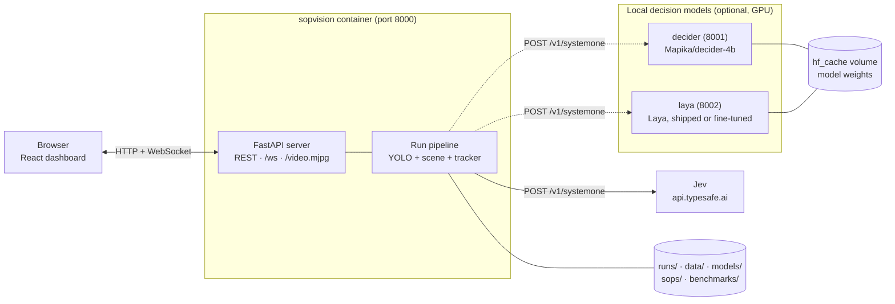
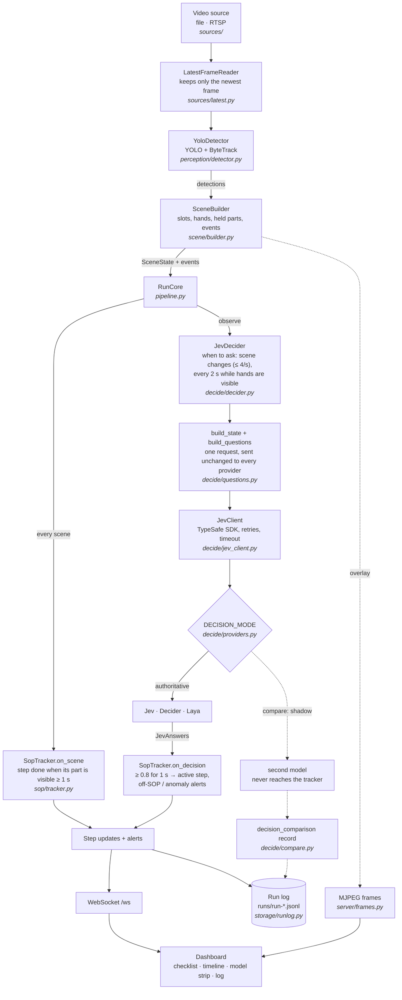
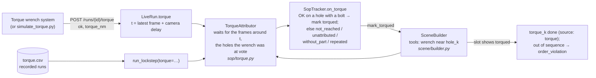
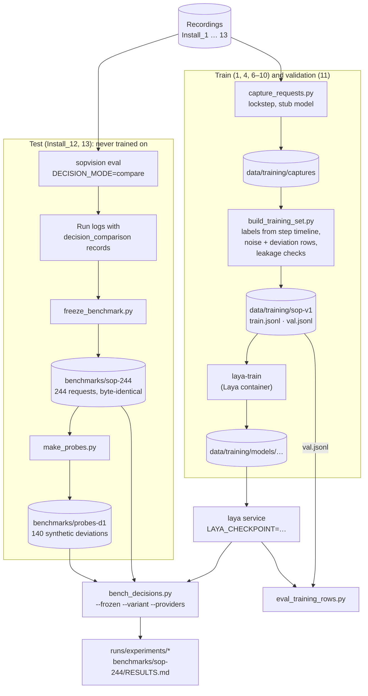

# SOP Vision: architecture

How the project is laid out and how a camera frame becomes an SOP step on the dashboard. For running it, see the
[README](../README.md); for the original design, [the spec](superpowers/specs/2026-10-01-sop-vision-design.md).

## In one paragraph

A YOLO detector turns each video frame into detections. The scene builder turns detections into a stable **scene
state** (which slots hold which part, where the hands are, what changed). The **tracker** completes a step when its part
is visibly in place, and a **decision model** answers three questions about the scene (which step is under way, is the
asked-about step done, is anything inconsistent with the SOP) that set the active step and raise off-SOP and anomaly
alerts. The decision model is Jev (TypeSafe's hosted API) or a local model (Decider or a fine-tuned Laya), all reached
through the same client and the same `POST /v1/systemone` request. Everything is logged and pushed to a React dashboard.

## Runtime services (Docker Compose)



| Service | Profile | What it is |
|---|---|---|
| `sopvision` | default | The app: FastAPI server, run pipeline, built dashboard (`Dockerfile` target `runtime`) |
| `decider` | `decider` | Mapika/decider-4b behind its own `/v1/systemone` server (`docker/decider.Dockerfile`, `decider_serve.py`) |
| `laya` | `laya` | Laya behind `laya-serve`; `LAYA_CHECKPOINT` swaps in a shared fine-tune, `registry.json` adds one per SOP (`docker/laya.Dockerfile`, `laya_serve.py`) |
| `worker` | default | Runs the SOP builder's background jobs (timeline drafts, slot auto-fit, Laya training) from `data/jobs` (`Dockerfile` target `worker`) |
| `tests` | `test` | Unit tests in the app's environment plus the dev group |
| `gpu-tests` | `test-gpu` | Opt-in GPU/API tests with mounted datasets and optional credentials |
| `tools` | `tools` | Python data, labelling, calibration, and evaluation utilities with training dependencies |
| `trainer` | `training` | The tools image with GPU access and a detector-training entrypoint |
| `web-tests` | `test` | Frontend tests and production build with container-owned Node dependencies |
| `web-dev` | `dev` | Vite development server (5173), forwarding API/WebSocket traffic to the app |
| `e2e` | `e2e` | Playwright in a browser against the running app and worker: a smoke pass over every page, and the lug-bolt SOP rebuilt through the UI and compared with `sops/lug_bolts.yaml` (`web/e2e`, `Dockerfile` target `e2e`) |
| `labelstudio` | `labelling` | Browser annotation for detector and reference boxes (8080), with persistent project storage |

Docker is the sole supported execution environment. Runtime model/SOP/scenario inputs remain read-only; tools
have writable mounts for generated datasets, labels, calibration, models, and reports. Host virtual environments
and Node installations are not required. `start.sh` and `stop.sh` orchestrate these containers.

`DECISION_MODE` picks who drives the tracker: `jev` (default), `decider`, `laya`, or `compare` (Jev drives,
`COMPARE_SHADOW` gets the same requests and both answers are logged side by side).

## The live flow: frame to dashboard



A few things that are easy to miss:

- **Video never waits for the model.** The pipeline thread does detection and the scene; the event loop runs the
  tracker and decisions. In live mode at most one decision call is in flight, and the reader drops frames rather than
  falling behind.
- **Steps complete on visual evidence.** On the test footage every step is completed by evidence. The decision model
  mainly sets the *active* step and raises off-SOP and anomaly alerts.
- **One request, many models.** The state and questions are built once. In compare mode the shadow model gets the
  identical request at the same moment, its answer only goes into the log, and its failures never affect the run.
- **Lockstep mode (`sopvision eval`)** processes every frame in order and applies each answer a fixed 0.5 s of video
  time later, so results don't depend on machine or network speed.

## Torque input (SOPs with a tool, e.g. lug bolts)

Some steps complete on an external signal rather than on what the camera sees: a torque wrench reports that a
tightening reached torque, but not on which nut. The camera supplies the *where*.



The camera's delay (how far its frames trail reality) is measured with the dashboard's latency page (`/#/latency`,
`sources/latency.py`) and stored per camera; recorded videos have none.

## The SOP builder (dashboard `#/sops`)

A new SOP is built in the dashboard from a trained YOLO detection model (docs/sop-builder.md):
detector import and class roles → recordings (`#/record`) → slot layout (auto-fit) → steps and order → step
timelines (`#/sops/<id>/runs/<run>`) → the SOP's own Laya checkpoint → publish. Drafts live in `sops/drafts/`
(`sopvision.builder.drafts`); publishing moves them into `sops/` and reloads the app's SOPs without a restart.
GPU work is queued as jobs (`sopvision.jobs`: a folder per job under `data/jobs`, fixed job kinds, never commands
from a request) and run one at a time by the `worker` service. Each SOP can have its own Laya checkpoint
(`data/training/models/registry.json`, `sopvision.decide.laya_registry`); the Laya service serves them side by
side and the app names the SOP's checkpoint in each request.

## Code layout

```
src/sopvision/
  cli.py            sopvision serve | eval | compare | doctor | calibrate | make-scenarios
  settings.py       environment / .env settings (decision mode, model URLs, paths)
  config.py         SOP YAML schema: steps, slots, order rules, thresholds
  pipeline.py       RunCore (tracker + logging + broadcast), LiveRun, run_lockstep
  sources/          file and RTSP (low-latency) sources; LatestFrameReader; source registry;
                    camera delay measurement (latency.py)
  perception/       YoloDetector (Ultralytics + ByteTrack)
  scene/            SceneBuilder (detections → SceneState + events), geometry, video overlay
  recordings.py     an SOP's recordings and step timelines, whichever dataset format (timeline / clips)
  decide/           when to ask (decider.py), what to ask (questions.py), the client (jev_client.py),
                    provider selection + readiness (providers.py), side-by-side records (compare.py)
  sop/              SopTracker: evidence completion, active step, order/removal/off-SOP/anomaly alerts;
                    torque results and their attribution to slots (torque.py)
  storage/          append-only JSONL run log, run report (JSON/CSV)
  server/           FastAPI app (REST, /ws, MJPEG), RunManager (one run at a time), frame buffer
  evaluation/       acceptance eval, report comparison, scenario videos, Jev-vs-local metrics, request variants,
                    SOP-driven deviation generators (deviations.py)
web/                React + Vite dashboard (built into the app image), on the deviceWISE suite's MUI theme: theme.ts and
                    theme/ are copied unchanged from devicewise-intelligence-suite/frontend, ui/ holds its page kit
                    (PageHeader look, Panel, KpiTile, FormDialog, ConfirmDialog, toasts); web/e2e has the Playwright tests
sops/               SOP definitions (server_fan.yaml); sops/drafts/ for SOPs without a trained detector yet (lug_bolts.yaml)
training/           YOLO detector: frame sampling, reference labelling, dataset build, training
scripts/            benchmarks, decision-model data pipeline, smoke tests (below)
docker/             Decider and Laya images and entrypoints; docker/certs for a corporate root CA
benchmarks/         frozen decision benchmark (sop-244) and deviation probes (probes-d1), with RESULTS.md
tests/              unit tests; tests/jev and tests/decider call real models (opt-in markers)
docs/               this file, design spec, notes, demo script, decision-model training
```

Generated and local-only (gitignored): `runs/` (run logs, eval reports, experiments), `models/` (YOLO weights),
`data/` (frames, scenarios, decision-model training data and checkpoints), `sop-sample-training-data/` (recordings).

## Decision-model evaluation and training

The local models are compared with Jev on recorded requests, and Laya is fine-tuned on requests captured from the
training recordings. Test-split recordings (server fan: Install_12 and 13) are never used for training. Every script
takes `--sop` (default: the first SOP in `sops/`).



| Script | Purpose |
|---|---|
| `scripts/bench_decisions.py` | Replay recorded or frozen requests through one or two providers; accuracy, acting rate, echo rate, latency |
| `scripts/freeze_benchmark.py` | Freeze compare-mode logs into a fixed, checksummed benchmark (refuses to overwrite) |
| `scripts/make_probes.py` | Synthetic deviation probes from a frozen set (evaluation only) |
| `scripts/capture_requests.py` | Capture decision requests from the training/validation recordings |
| `scripts/build_training_set.py` | Labelled, augmented Laya-format rows, with leakage checks against the frozen sets |
| `scripts/eval_training_rows.py` | Score a provider on training-format rows (validation) |
| `scripts/simulate_torque.py` | Send torque results to a running app (interactive, periodic, or a recorded log) |
| `scripts/decider_vision_smoke.py` | Smoke test for Mapika/decider-2b-vision (not used for decisions) |
| `scripts/docker_smoke.py` | The app image builds, sees the GPU and serves the API |

Details: [decision-model training](decision-model-training.md) and the
[benchmark results](../benchmarks/sop-244/RESULTS.md).
