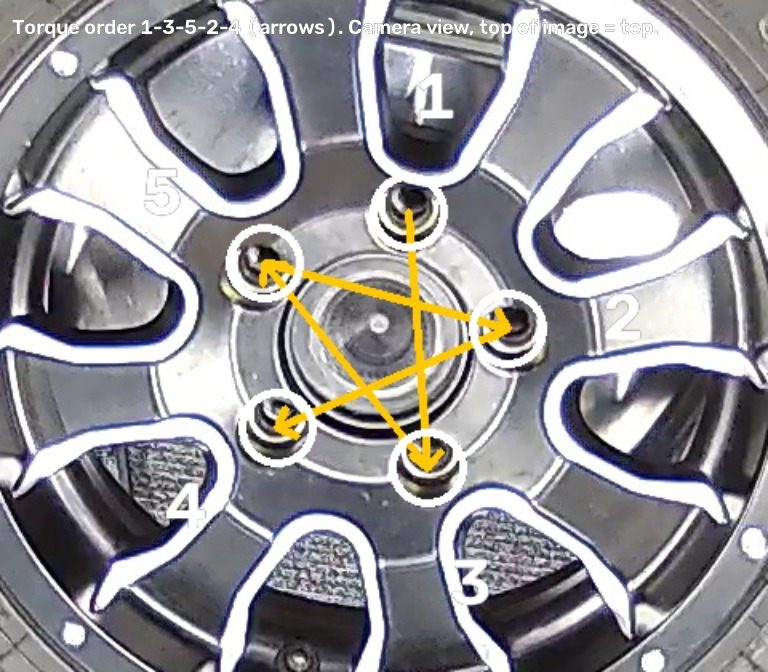

# Lug bolts proof of concept

Second SOP for SOP Vision: put five lug bolts on a wheel, then torque them in star sequence with an automatic torque
wrench whose results we receive. A fine-tuned local Laya model makes the decisions, because the target is an edge
device (hardware not chosen yet). See [ARCHITECTURE.md](ARCHITECTURE.md) for how the system fits together.

## The SOP



Holes are numbered **as the camera sees them from above**: hole 1 is the one nearest the top of the camera image, then
2-5 go clockwise in the image. The torque order is 1 → 3 → 5 → 2 → 4 (the arrows).

| Group | Steps | Done when | Order |
|---|---|---|---|
| Place | place_1 … place_5 | a lug bolt is visibly in that hole (vision) | any order |
| Torque | torque_1, torque_3, torque_5, torque_2, torque_4 | a torque-OK result from the wrench, attributed to the hole the wrench head is on | this sequence |

Alerts: torquing out of sequence (`order_violation`), a torque result that can't be placed on a hole
(`torque_unattributed`), a result that didn't reach torque (`torque_not_reached`), torquing a hole with no bolt in it
(`torque_without_part`), re-torquing a done hole (`torque_repeated`), a bolt removed after it was torqued
(`part_removed`), and the existing SOP-incomplete, off-SOP and anomaly alerts.

The sequence check is deterministic (tracker); the model names the step under way and judges off-SOP and anomalies.

SOP file: `sops/lug_bolts.yaml` (a draft in `sops/drafts/` until the detector was trained, since the app requires weights
for every SOP it loads).

## Phase A: software, no recordings needed (done)

| Piece | Where | How to use |
|---|---|---|
| SOP rules: any-order then sequence groups, tool classes, `torqued` evidence | `config.py`, `sops/lug_bolts.yaml` | `order: groups` with `- sequence: [...]`; `layout.tools`; evidence `{hole_3: torqued}` |
| Tools in the scene (where the wrench is), `torqued` on slots | `scene/builder.py`, `scene/types.py` | appears in the model's state only for SOPs that use them (server fan's state is unchanged) |
| Torque results and attribution | `sop/torque.py`, `sop/tracker.py`, `pipeline.py` | a result waits for the frames around it, then the holes the wrench was at vote; alerts listed above |
| Torque input (generic adapter) | `POST /runs/{id}/torque` `{"ok": true, "torque_nm": 110}` | any system or bridge can push results; a real MQTT/serial adapter just calls this |
| Simulator / log replay | `scripts/simulate_torque.py` | interactive (Enter = OK), `--every 5`, or `--log torque.csv` in time with a video |
| Recorded torque logs | `run_lockstep(..., torque=...)`, `read_torque_log` | replayed with each recording during capture and evaluation |
| RTSP low latency, camera delay | `sources/rtsp.py`, `CAMERA_DELAY_MS`, `RTSP_LOW_LATENCY` | measured delays override the default per camera |
| Latency check | dashboard `/#/latency` (link in the top bar), `POST /latency/measure` | point the camera at the QR code, measure, save |
| Dataset formats, recordings loader | `recordings.py`, `dataset:` in the SOP file | `timeline` (below) for new SOPs; server fan keeps `clips` |
| SOP-driven deviations, capture, training set, benchmark | `evaluation/deviations.py`, `scripts/*` with `--sop` | same pipeline as server fan (docs/decision-model-training.md) |

Verified: 300+ unit tests including a synthetic end-to-end lug-bolt run (correct run completes all 10 steps; clockwise
torquing, a missing bolt, torque not reached and an unseen wrench raise their alerts); server fan unchanged on real data
(a re-capture of Install_11 is byte-identical to the one before these changes, and all 244 frozen labels reproduce).

Not generalised (server-fan only, not needed for the lug-bolt path): `sopvision eval` acceptance criteria and its
scenario videos, `sopvision calibrate`, and the reference-frame labelling tool (`training/reference_labels.py`). Label
the lug-bolt detector with the Label Studio route (`training/labelstudio.py`, `training/autolabel.py`).

### Trying the torque flow before the wrench is connected

With the lug-bolt detector trained (it is: `models/lug_bolts`), start a run on the dashboard,
and in another terminal: `docker compose run --rm --entrypoint python sopvision scripts/simulate_torque.py --url
http://sopvision:8000` (Enter sends a torque-OK result; the app works out which hole from the video).

## Phase B: recordings (to do on site)

### Camera (set up 2026-10-09)

Amcrest, `rtsp://…/cam/realmonitor?channel=1&subtype=0` (main stream), 1920x1080 H.264, ~23 fps delivered, measured
delay ~390 ms (saved per camera; re-measure after changing camera settings). Turn off the on-screen overlays
(timestamp, "IPC", logo) and Smart Codec / H.264+.

**Camera shake.** The camera is mounted on the torque frame and shakes while torquing (measured on the first two
recordings: typically 2-6 px, up to ~35 px, with some motion blur; holes are ~100 px apart). The SOP sets
`layout.anchor_follow: 0.7` so the hole grid follows the hub almost frame by frame (server fan keeps 0.1, its steady
camera's smoothing); shaky frames stay in the training data, which teaches the detector blurred bolts. Decoupling the
camera from the frame (or rubber isolators) and a shorter shutter (~1/250 s) would reduce it further; if the camera is
re-mounted, hole positions must be measured again.

The hub is fixed and the wheel turns on it, so the holes stay put in the image: the SOP's reference object is the
**hub** (`anchor: hub`), labelled as a square around the five holes with a hole's width of margin. The hub is small in
the frame (a bolt is ~35 px at 1080p); lowering or zooming the camera so the rim fills more of it helps the detector,
and the coloured-bolt stage will need it.

- The production overhead position, fixed; the whole wheel and the wrench head in view.
- H.264, 1080p, 25-30 fps, keyframe interval ~1 s, no B-frames, low-latency mode if the camera has one; wired.
- Measure the delay once with the latency check (`/#/latency` on the dashboard) and keep the number.

### Deviation runs (10: 6 train, 4 test)

Start each with 3-5 s of empty holes, mix bolt colours, press **T** whenever a bolt reaches torque even when torquing it
is the mistake (**N** for a tightening stopped early). Test runs use the same kinds of mistakes in different variations.

| Split | Name | Do this | Expected alerts |
|---|---|---|---|
| train | `dev01-clockwise` | place all; torque 1-2-3-4-5 | order violation |
| train | `dev02-torque-early` | place 1, 2, 3; torque 1 with holes 4-5 empty; place 4, 5; torque 3-5-2-4 | order violation |
| train | `dev03-not-reached-retorque` | place all; torque 1; hole 3 stopped early (N) then torqued (T); 5-2-4; torque 1 again | not reached; repeated |
| train | `dev04-skip-hole` | place all; torque 1-3-(skip 5)-2-4 | order violation; incomplete |
| train | `dev05-removed-idle` | place all; torque 1, 3; unscrew bolt 3, hold it up, put back; away ~20 s; torque 3, then 5-2-4 | part removed; idle |
| train | `dev06-missing-bolt-offsop` | bolts in 1, 2, 3, 5 (forget 4); torque 1-3-5-2; wiggle the wheel ~10 s; place and torque 4 | order violation; off-SOP |
| test | `test-dev01-counterclockwise` | place all; torque 1-5-4-3-2 | order violation |
| test | `test-dev02-early-and-repeat` | place 1, 5; torque 5; place the rest; torque 1-3-5(again)-2-4 | order violation; repeated |
| test | `test-dev03-removed-not-reached` | place all; torque 1-3-5; unscrew bolt 1, leave it out; hole 2 N then T; torque 4 | part removed; not reached; incomplete |
| test | `test-dev04-idle-offsop` | place all slowly; away ~30 s; torque 1, 3; reach across / set something on the hub ~10 s; torque 3 again, then 5-2-4 | idle; off-SOP; repeated |

Torquing an empty hole can't happen with a real wrench, so it isn't acted out; the `torque_without_part` alert stays as
a safety check for the camera missing a bolt or misplacing the wrench. A `notes.txt` in the run folder ("~25 s: skipped hole 5")
makes writing `steps.csv` quicker.

### Bolt colours

Use all four colours (blue, green, red, gold), mixed: vary which colour goes in which hole between runs (so the detector
learns colour, not position), include a few single-colour runs, and keep the colour counts roughly even. Record a few
seconds of **empty holes** at the start of each run, before the first bolt goes in. From straight overhead a loosely
started bolt looks like a seated one; that's fine here, since the torque press confirms it's tight.

### What to record

| Set | Runs | Content |
|---|---|---|
| Train | 10-12 | correct runs: all 5 bolts placed (any order), torqued 1-3-5-2-4 |
| Validation | 2 | correct runs |
| Test | 3-4 | correct runs, never used for training |
| Deviations (train) | 6-8 | the deviations below, mixed |
| Deviations (test) | 4-6 | the deviations below, never used for training |

Deviations: torquing out of sequence; skipping a hole; torquing a hole with no bolt in it; re-torquing a hole; the wrench
held on the wrong hole; a bolt removed after torquing; idle pauses (10-30 s, hands away); off-SOP handling (adjusting
the wheel, reaching across). Vary operators, lighting and wheels where possible.

### Recording a run (dashboard → Record, `/#/record`)

1. Stop any run. Pick the SOP (*Wheel lug bolts*), the camera, the split (train / val / test) and a name, e.g.
   `r07-wrong-order`; press **Start recording**. The preview shows what is being recorded.
2. Do the run. Every time the wrench reaches torque, press **Torque reached** (or key **T**); **Not reached** (**N**)
   for a tightening that didn't. Until the wrench reports by itself, these presses are the torque log.
3. **Stop and save.** The run lands in `datasets/lug_bolts/runs/<name>/` (video.mp4, torque.csv, meta.json) and is
   listed under its split in `datasets/lug_bolts/splits.yaml`.
4. Add `steps.csv` to the run folder (below) by watching the video; until then the run is not used for labels.

Frames are written on a fixed 25 fps clock (repeating or skipping camera frames), so video time is real time, and
each press is stored at *press time + camera delay*: the moment of the video that shows it.

### Files per run

```
<dataset>/runs/<run_id>/
    video.mp4        the camera recording
    torque.csv       one row per tightening: time_s, ok, torque_nm   (time_s on the video's timeline)
    steps.csv        one row per step: step_id, start_s, end_s        (step ids from the SOP file; idle/off_sop for gaps)
    notes.txt        optional: which deviations happened, and when
<dataset>/splits.yaml   which run ids are train / val / test, e.g.  train: [r01, r02]  val: [r03]  test: [r04]
```

`<dataset>` is `DATASETS_DIR/lug_bolts`: the project's `datasets/lug_bolts/` (Docker mounts `./datasets` at `/datasets`).
The Record page creates the run folder, `video.mp4`, `torque.csv` and the `splits.yaml` entry; `steps.csv` is added by
hand.

**Clock sync** is the one thing that must be right: `torque.csv` times must be on the video's timeline. Either log both
on the same computer, or start each recording with a visible sync event (torque the first bolt in view and note the
frame where the wrench clicks).

### Then

Label frames for the detector (classes: hub, hole_empty, lug_bolt_blue/green/red/gold, torque_wrench, hand); train YOLO; capture
requests from the train/val runs; build the training set (labels from `steps.csv`/`torque.csv`, deviation rows);
fine-tune Laya (12+ epochs); score on the test runs and the deviation test runs; serve with `LAYA_CHECKPOINT`.

## Detector labels

All in Docker; train and val runs only (test runs are never sampled). Build the shared tooling image with
`docker compose build tools`. Run CPU modules with `docker compose run --rm tools -m training.<module>`;
GPU modules use `docker compose run --rm --entrypoint python trainer -m training.<module>`.

1. Sample frames: `training/sample_recordings.py` -> `data/lug_bolts/frames` (every 4 s, plus one just before each
   torque press, when the wrench is on a bolt).
2. Hands and wrench, zero-shot: `training/zero_shot_boxes.py` (Grounding DINO) -> `data/lug_bolts/zero_shot.jsonl`,
   using the `trainer` image's torch/transformers dependencies and GPU. This no longer depends on Decider's image.
3. Pre-label: `training/prelabel_bolts.py` -> `data/lug_bolts/labels_auto`. The holes sit at fixed pixel positions (the
   wheel isn't turned between runs), followed through camera shake. A bolt is the colour filling the hole; no colour
   means an empty hole, or the wrench socket if that hole already had a bolt in the run.
4. Review in Label Studio: `docker compose --profile labelling up -d labelstudio`, http://localhost:8080. Labelling
   setup: `data/lug_bolts/labelstudio/config.xml`; import `data/lug_bolts/labelstudio/tasks.json` (flagged frames
   first). Fix every box, then export JSON.
5. `docker compose run --rm tools -m training.labelstudio --sop sops/lug_bolts.yaml import --export <export.json>
   --manifest data/lug_bolts/frames/manifest.jsonl --labels data/lug_bolts/labels_auto --out data/lug_bolts/yolo`,
   then train the detector:
   `docker compose --profile training run --rm trainer train --data data/lug_bolts/yolo/dataset.yaml --out models/lug_bolts`
   (YOLO26m at 1280 px, batch 4, up to 100 epochs with early stopping; `best.pt` and `metrics.json` go to
   `models/lug_bolts`, curves and per-class results to `data/ultralytics/lug_bolts`).

Box rules: `hub` is a square around the five holes with about a bolt head of margin. Each hole gets exactly one of
`hole_empty` or a bolt colour, unless something hides it. `torque_wrench` is the head/socket end only, not the
handle. `hand` is every visible hand, including gloved hands. Box a bolt in a hand if it is clearly visible.

## Step timelines (steps.csv)

Each run needs `steps.csv` (`step_id,start_s,end_s`): which step was under way when. It's the ground truth for scoring
and training the decision model. For now these are drafted by machine and corrected by hand:

1. `docker compose run --rm --entrypoint python trainer scripts/draft_steps.py draft --sop sops/lug_bolts.yaml` replays every recording through the detector and tracker
   (no decision model) and writes `data/lug_bolts/steps/<run>.csv` plus `REVIEW.md` (each run's alerts and the steps
   the tracker never completed). A step runs from the previous completion to its own; 5 s or more with nobody at the
   wheel is `idle`.
2. Correct each draft against its video: add what the tracker can't see (a removed bolt, `off_sop` stretches such as
   wiggling the wheel or reaching across the hub, steps it never completed) and fix boundaries.
3. `docker compose run --rm tools scripts/draft_steps.py install --sop sops/lug_bolts.yaml` checks every file and copies it to
   `datasets/lug_bolts/runs/<run>/steps.csv`.

Planned: a dashboard page where the person who recorded the run marks step changes while watching it, so building
an SOP doesn't need these scripts.

## Edge readiness

Nothing on the decision path depends on Jev. YOLO exports to ONNX/TensorRT and Laya has an ONNX path; we benchmark
both on CPU here as a worst case before choosing hardware.

## Later: coloured bolts (labels already in place)

The detector is trained with one class per bolt colour from the start (lug_bolt_blue/green/red/gold), and this SOP
accepts any colour in any hole. The coloured stage only changes `filled_by` per hole in the SOP file (e.g.
`hole_3: {filled_by: lug_bolt_red}`): no relabelling, no new detector.
